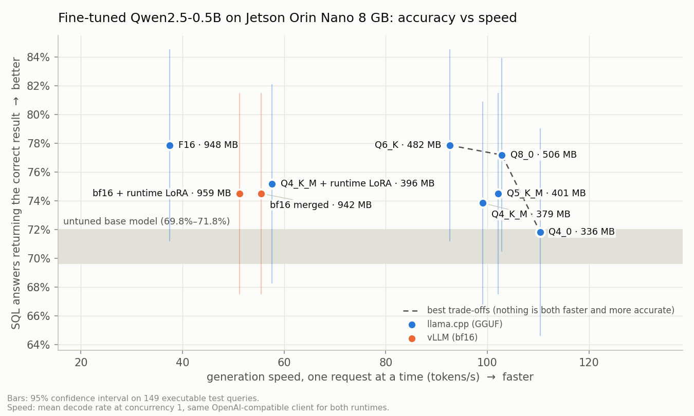
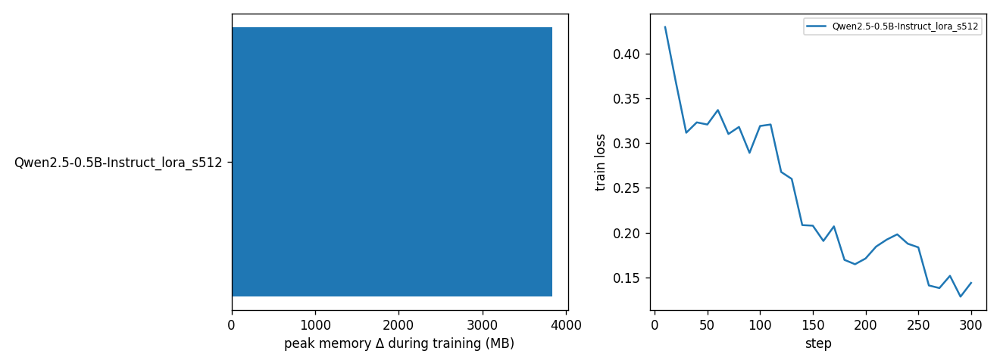
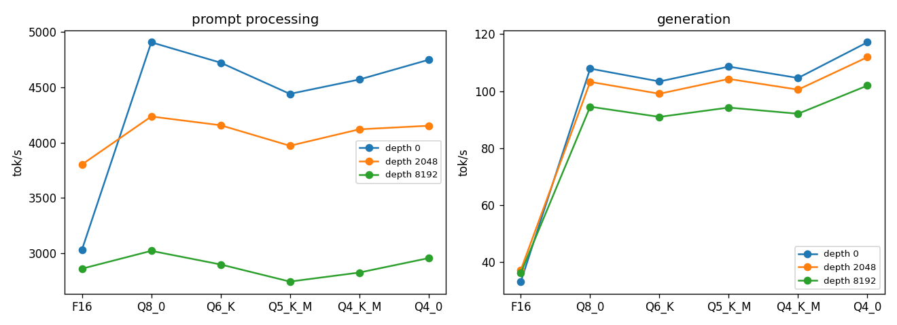
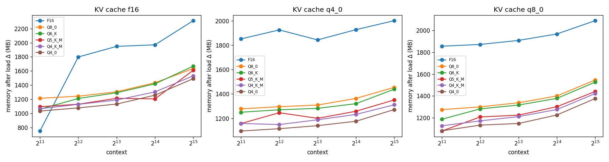
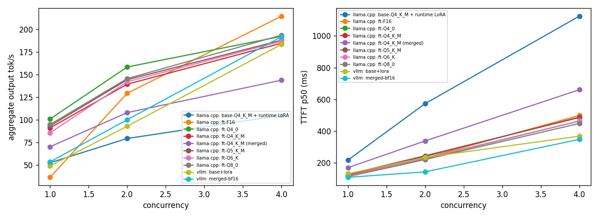

# Orin Nano LoRA fine-tune + serving benchmark

Device: **NVIDIA Jetson Orin Nano Engineering Reference Developer Kit Super** · # R36 (release), REVISION: 5.0, GCID: 43688277, BOARD: generic, EABI: aarch64, DATE: Fri Jan 16 03:50:45 UTC 2026 · RAM 7607 MB · swap 3803 MB · power mode `MAXN_SUPER`

## Summary: accuracy vs speed

| runtime | variant | MB | decode tok/s (1 req) | exec match (95% CI) | best trade-off |
|---|---|---|---|---|---|
| llama.cpp | F16 | 948 | 37.5 | 77.8% ± 6.7% |  |
| llama.cpp | Q6_K | 482 | 92.7 | 77.8% ± 6.7% | ✓ |
| llama.cpp | Q8_0 | 506 | 102.9 | 77.2% ± 6.7% | ✓ |
| llama.cpp | Q4_K_M + runtime LoRA | 396 | 57.6 | 75.2% ± 6.9% |  |
| llama.cpp | Q5_K_M | 401 | 102.1 | 74.5% ± 7.0% |  |
| vllm | bf16 merged | 942 | 55.5 | 74.5% ± 7.0% |  |
| vllm | bf16 + runtime LoRA | 959 | 51.2 | 74.5% ± 7.0% |  |
| llama.cpp | Q4_K_M | 379 | 99.1 | 73.8% ± 7.1% |  |
| llama.cpp | Q4_0 | 336 | 110.4 | 71.8% ± 7.2% | ✓ |

## 1. Fine-tuning (LoRA vs QLoRA)

| run | status | trainable params | peak used MB (system) | peak Δ MB | torch peak alloc MB | swap peak MB | s/step | train tok/s | runtime s | eval loss | eval ppl |
|---|---|---|---|---|---|---|---|---|---|---|---|
| Qwen2.5-0.5B-Instruct_lora_s512 | ok | 8798208 | 7344 | 3834 | 2008 | 1672 | 13.73 | 216.7 | 4134 | 0.2554 | 1.291 |
| Qwen2.5-1.5B-Instruct_lora_s512 | oom | 18464768 | 7358 | 2764 | 3480 | 1968 |  |  |  |  |  |
| Qwen2.5-1.5B-Instruct_qlora_s512 | oom | 18464768 | 7408 | 3268 | 3116 | 2183 |  |  |  |  |  |
| Qwen2.5-1.5B-Instruct_qlora_s1024 | oom | 18464768 | 7387 | 3239 | 2941 | 1675 |  |  |  |  |  |

## 2. Exported model sizes

| file | MB |
|---|---|
| base-F16.gguf | 948 |
| base-Q4_K_M.gguf | 379 |
| base-Q8_0.gguf | 506 |
| ft-F16.gguf | 948 |
| ft-Q4_0.gguf | 336 |
| ft-Q4_K_M.gguf | 379 |
| ft-Q5_K_M.gguf | 401 |
| ft-Q6_K.gguf | 482 |
| ft-Q8_0.gguf | 506 |
| lora-F16.gguf | 17 |
| merged | 942 |

## 3. llama.cpp (GGUF)

### llama-bench throughput (pp512 / tg128)

| quant | test | depth | tok/s | ± | size MB |
|---|---|---|---|---|---|
| F16 | pp | 0 | 3034 | 356.2 | 942 |
| F16 | pp | 2048 | 3802 | 165.4 | 942 |
| F16 | pp | 8192 | 2862 | 42.24 | 942 |
| F16 | tg | 0 | 33.26 | 6.74 | 942 |
| F16 | tg | 2048 | 37.37 | 0.15 | 942 |
| F16 | tg | 8192 | 36.32 | 0.05 | 942 |
| Q8_0 | pp | 0 | 4905 | 186.6 | 501 |
| Q8_0 | pp | 2048 | 4235 | 129.3 | 501 |
| Q8_0 | pp | 8192 | 3023 | 128.6 | 501 |
| Q8_0 | tg | 0 | 107.9 | 0.29 | 501 |
| Q8_0 | tg | 2048 | 103.2 | 0.56 | 501 |
| Q8_0 | tg | 8192 | 94.52 | 0.54 | 501 |
| Q6_K | pp | 0 | 4721 | 389.1 | 477 |
| Q6_K | pp | 2048 | 4156 | 222.6 | 477 |
| Q6_K | pp | 8192 | 2900 | 13.79 | 477 |
| Q6_K | tg | 0 | 103.4 | 0.47 | 477 |
| Q6_K | tg | 2048 | 99.07 | 0.07 | 477 |
| Q6_K | tg | 8192 | 90.96 | 0.25 | 477 |
| Q5_K_M | pp | 0 | 4439 | 154 | 395 |
| Q5_K_M | pp | 2048 | 3971 | 192.5 | 395 |
| Q5_K_M | pp | 8192 | 2746 | 68.9 | 395 |
| Q5_K_M | tg | 0 | 108.6 | 0.46 | 395 |
| Q5_K_M | tg | 2048 | 104.2 | 0.07 | 395 |
| Q5_K_M | tg | 8192 | 94.22 | 0.91 | 395 |
| Q4_K_M | pp | 0 | 4569 | 184.6 | 374 |
| Q4_K_M | pp | 2048 | 4119 | 12.46 | 374 |
| Q4_K_M | pp | 8192 | 2827 | 70.78 | 374 |
| Q4_K_M | tg | 0 | 104.6 | 0.28 | 374 |
| Q4_K_M | tg | 2048 | 100.5 | 0.43 | 374 |
| Q4_K_M | tg | 8192 | 92.06 | 0.23 | 374 |
| Q4_0 | pp | 0 | 4747 | 254.9 | 330 |
| Q4_0 | pp | 2048 | 4152 | 348.4 | 330 |
| Q4_0 | pp | 8192 | 2957 | 23.45 | 330 |
| Q4_0 | tg | 0 | 117.1 | 0.99 | 330 |
| Q4_0 | tg | 2048 | 111.9 | 0.42 | 330 |
| Q4_0 | tg | 8192 | 101.9 | 0.54 | 330 |

### Perplexity on held-out task text (lower is better)

| quant | ppl | ppl_err |
|---|---|---|
| F16 | 2.057 | 0.03195 |
| Q8_0 | 2.062 | 0.0321 |
| Q6_K | 2.061 | 0.03204 |
| Q5_K_M | 2.082 | 0.03252 |
| Q4_K_M | 2.106 | 0.03322 |
| Q4_0 | 2.128 | 0.03362 |

### Memory fit: quant × KV type × context

| quant | KV | ctx | status | load Δ MB | probe prompt tok | probe TTFT ms | probe TPOT ms | probe peak Δ MB | swap MB |
|---|---|---|---|---|---|---|---|---|---|
| F16 | f16 | 2048 | ok | 751 | 1843 | 527 | 27.35 | 1135 | 1364 |
| F16 | f16 | 4096 | ok | 1798 | 3686 | 920.7 | 27.35 | 1903 | 1362 |
| F16 | f16 | 8192 | ok | 1948 | 7372 | 1972 | 28.06 | 1962 | 1363 |
| F16 | f16 | 16384 | ok | 1970 | 14745 | 4720 | 29.1 | 2062 | 1375 |
| F16 | f16 | 32768 | ok | 2312 |  |  |  |  |  |
| F16 | q4_0 | 2048 | ok | 1851 | 1843 | 487.3 | 29.99 | 1923 | 1367 |
| F16 | q4_0 | 4096 | ok | 1925 | 3686 | 938.5 | 29.74 | 2002 | 1344 |
| F16 | q4_0 | 8192 | ok | 1843 | 7372 | 2022 | 32.03 | 1910 | 1343 |
| F16 | q4_0 | 16384 | ok | 1927 | 14745 | 4876 | 36.22 | 2000 | 1343 |
| F16 | q4_0 | 32768 | ok | 2001 |  |  |  |  |  |
| F16 | q8_0 | 2048 | ok | 1856 | 1843 | 481.7 | 28.98 | 1927 | 1374 |
| F16 | q8_0 | 4096 | ok | 1872 | 3686 | 929.8 | 29.63 | 1944 | 1373 |
| F16 | q8_0 | 8192 | ok | 1909 | 7372 | 2022 | 31.36 | 1985 | 1372 |
| F16 | q8_0 | 16384 | ok | 1968 | 14745 | 4876 | 34.82 | 2042 | 1372 |
| F16 | q8_0 | 32768 | ok | 2090 |  |  |  |  |  |
| Q8_0 | f16 | 2048 | ok | 1214 | 1843 | 403.4 | 10.43 | 1227 | 1343 |
| Q8_0 | f16 | 4096 | ok | 1243 | 3686 | 820.1 | 10.25 | 1256 | 1343 |
| Q8_0 | f16 | 8192 | ok | 1306 | 7372 | 1843 | 11.1 | 1317 | 1343 |
| Q8_0 | f16 | 16384 | ok | 1433 | 14745 | 4549 | 12.27 | 1445 | 1342 |
| Q8_0 | f16 | 32768 | ok | 1635 |  |  |  |  |  |
| Q8_0 | q4_0 | 2048 | ok | 1278 | 1843 | 420.5 | 12.04 | 1307 | 1336 |
| Q8_0 | q4_0 | 4096 | ok | 1295 | 3686 | 858.6 | 13.18 | 1311 | 1336 |
| Q8_0 | q4_0 | 8192 | ok | 1309 | 7372 | 1920 | 15.27 | 1339 | 1336 |
| Q8_0 | q4_0 | 16384 | ok | 1363 | 14745 | 4733 | 19.61 | 1383 | 1336 |
| Q8_0 | q4_0 | 32768 | ok | 1454 |  |  |  |  |  |
| Q8_0 | q8_0 | 2048 | ok | 1275 | 1843 | 421 | 12.06 | 1304 | 1342 |
| Q8_0 | q8_0 | 4096 | ok | 1300 | 3686 | 871.6 | 12.78 | 1332 | 1342 |
| Q8_0 | q8_0 | 8192 | ok | 1338 | 7372 | 1937 | 14.51 | 1369 | 1338 |
| Q8_0 | q8_0 | 16384 | ok | 1400 | 14745 | 4737 | 18.01 | 1431 | 1337 |
| Q8_0 | q8_0 | 32768 | ok | 1547 |  |  |  |  |  |
| Q6_K | f16 | 2048 | ok | 1060 | 1843 | 440.9 | 10.34 | 1092 | 1336 |
| Q6_K | f16 | 4096 | ok | 1211 | 3686 | 850.7 | 10.83 | 1237 | 1336 |
| Q6_K | f16 | 8192 | ok | 1292 | 7372 | 1917 | 11.35 | 1303 | 1336 |
| Q6_K | f16 | 16384 | ok | 1418 | 14745 | 4730 | 13.46 | 1438 | 1335 |
| Q6_K | f16 | 32768 | ok | 1669 |  |  |  |  |  |
| Q6_K | q4_0 | 2048 | ok | 1250 | 1843 | 440.9 | 13 | 1278 | 1306 |
| Q6_K | q4_0 | 4096 | ok | 1270 | 3686 | 890.5 | 13.76 | 1292 | 1304 |
| Q6_K | q4_0 | 8192 | ok | 1282 | 7372 | 1982 | 15.64 | 1316 | 1304 |
| Q6_K | q4_0 | 16384 | ok | 1320 | 14745 | 4849 | 19.97 | 1360 | 1304 |
| Q6_K | q4_0 | 32768 | ok | 1439 |  |  |  |  |  |
| Q6_K | q8_0 | 2048 | ok | 1187 | 1843 | 439.8 | 13.07 | 1215 | 1335 |
| Q6_K | q8_0 | 4096 | ok | 1282 | 3686 | 889.9 | 13.15 | 1310 | 1335 |
| Q6_K | q8_0 | 8192 | ok | 1317 | 7372 | 1982 | 15.03 | 1347 | 1334 |
| Q6_K | q8_0 | 16384 | ok | 1378 | 14745 | 4852 | 18.5 | 1407 | 1334 |
| Q6_K | q8_0 | 32768 | ok | 1527 |  |  |  |  |  |
| Q5_K_M | f16 | 2048 | ok | 1095 | 1843 | 482.4 | 9.93 | 1130 | 1303 |
| Q5_K_M | f16 | 4096 | ok | 1130 | 3686 | 917.7 | 10.59 | 1150 | 1302 |
| Q5_K_M | f16 | 8192 | ok | 1214 | 7372 | 2027 | 10.74 | 1242 | 1302 |
| Q5_K_M | f16 | 16384 | ok | 1205 | 14745 | 4925 | 12.21 | 1226 | 1291 |
| Q5_K_M | f16 | 32768 | ok | 1611 |  |  |  |  |  |
| Q5_K_M | q4_0 | 2048 | ok | 1157 | 1843 | 474.6 | 12.46 | 1196 | 1290 |
| Q5_K_M | q4_0 | 4096 | ok | 1246 | 3686 | 967 | 13.89 | 1291 | 1286 |
| Q5_K_M | q4_0 | 8192 | ok | 1200 | 7372 | 2335 | 16.88 | 1239 | 1285 |
| Q5_K_M | q4_0 | 16384 | ok | 1258 | 14745 | 5108 | 19.66 | 1304 | 1285 |
| Q5_K_M | q4_0 | 32768 | ok | 1351 |  |  |  |  |  |
| Q5_K_M | q8_0 | 2048 | ok | 1079 | 1843 | 474.1 | 12.42 | 1128 | 1290 |
| Q5_K_M | q8_0 | 4096 | ok | 1208 | 3686 | 953.6 | 12.87 | 1251 | 1290 |
| Q5_K_M | q8_0 | 8192 | ok | 1224 | 7372 | 2104 | 14.7 | 1264 | 1290 |
| Q5_K_M | q8_0 | 16384 | ok | 1302 | 14745 | 5094 | 18.22 | 1332 | 1290 |
| Q5_K_M | q8_0 | 32768 | ok | 1441 |  |  |  |  |  |
| Q4_K_M | f16 | 2048 | ok | 1066 | 1843 | 469.6 | 10.52 | 1108 | 1284 |
| Q4_K_M | f16 | 4096 | ok | 1128 | 3686 | 892.5 | 10.52 | 1157 | 1284 |
| Q4_K_M | f16 | 8192 | ok | 1189 | 7372 | 1972 | 11.51 | 1205 | 1284 |
| Q4_K_M | f16 | 16384 | ok | 1304 | 14745 | 4797 | 12.09 | 1339 | 1284 |
| Q4_K_M | f16 | 32768 | ok | 1532 |  |  |  |  |  |
| Q4_K_M | q4_0 | 2048 | ok | 1158 | 1843 | 457.9 | 12.66 | 1192 | 1284 |
| Q4_K_M | q4_0 | 4096 | ok | 1149 | 3686 | 921.1 | 13.21 | 1190 | 1284 |
| Q4_K_M | q4_0 | 8192 | ok | 1188 | 7372 | 2045 | 15.34 | 1222 | 1284 |
| Q4_K_M | q4_0 | 16384 | ok | 1232 | 14745 | 4959 | 19.98 | 1265 | 1284 |
| Q4_K_M | q4_0 | 32768 | ok | 1311 |  |  |  |  |  |
| Q4_K_M | q8_0 | 2048 | ok | 1127 | 1843 | 473.1 | 12.67 | 1157 | 1284 |
| Q4_K_M | q8_0 | 4096 | ok | 1172 | 3686 | 935.4 | 12.99 | 1205 | 1284 |
| Q4_K_M | q8_0 | 8192 | ok | 1211 | 7372 | 2047 | 16.1 | 1245 | 1284 |
| Q4_K_M | q8_0 | 16384 | ok | 1276 | 14745 | 4976 | 18.46 | 1317 | 1284 |
| Q4_K_M | q8_0 | 32768 | ok | 1422 |  |  |  |  |  |
| Q4_0 | f16 | 2048 | ok | 1033 | 1843 | 423.1 | 9.45 | 1045 | 1284 |
| Q4_0 | f16 | 4096 | ok | 1078 | 3686 | 835.9 | 9.72 | 1087 | 1284 |
| Q4_0 | f16 | 8192 | ok | 1132 | 7372 | 1889 | 10.3 | 1147 | 1284 |
| Q4_0 | f16 | 16384 | ok | 1258 | 14745 | 4631 | 11.17 | 1277 | 1284 |
| Q4_0 | f16 | 32768 | ok | 1492 |  |  |  |  |  |
| Q4_0 | q4_0 | 2048 | ok | 1096 | 1843 | 425.7 | 11.59 | 1121 | 1283 |
| Q4_0 | q4_0 | 4096 | ok | 1115 | 3686 | 867.2 | 12.35 | 1147 | 1283 |
| Q4_0 | q4_0 | 8192 | ok | 1140 | 7372 | 1921 | 14.45 | 1172 | 1283 |
| Q4_0 | q4_0 | 16384 | ok | 1176 | 14745 | 4709 | 18.61 | 1203 | 1283 |
| Q4_0 | q4_0 | 32768 | ok | 1272 |  |  |  |  |  |
| Q4_0 | q8_0 | 2048 | ok | 1081 | 1843 | 431.9 | 11.18 | 1108 | 1284 |
| Q4_0 | q8_0 | 4096 | ok | 1133 | 3686 | 934.2 | 12.75 | 1166 | 1283 |
| Q4_0 | q8_0 | 8192 | ok | 1148 | 7372 | 1945 | 13.59 | 1174 | 1283 |
| Q4_0 | q8_0 | 16384 | ok | 1226 | 14745 | 4733 | 17.05 | 1248 | 1283 |
| Q4_0 | q8_0 | 32768 | ok | 1377 |  |  |  |  |  |

## 4. vLLM

### Memory fit: gpu-memory-utilization × max-model-len

| variant | gpu util | max len | status | KV tokens | max conc × | weights GiB | load Δ MB | startup s |
|---|---|---|---|---|---|---|---|---|
| base+lora | 0.4 | 2048 | ok | 8.248e+04 | 40.27 | 0.94 | 4171 | 209.3 |
| base+lora | 0.4 | 4096 | ok | 7.339e+04 | 17.92 | 0.94 | 4394 | 218 |
| base+lora | 0.4 | 8192 | ok | 6.99e+04 | 8.53 | 0.94 | 4332 | 213.3 |
| base+lora | 0.4 | 16384 | ok | 6.859e+04 | 4.19 | 0.94 | 4328 | 233 |
| base+lora | 0.5 | 2048 | fail |  |  |  |  |  |
| base+lora | 0.6 | 2048 | fail |  |  |  |  |  |
| merged-bf16 | 0.4 | 2048 | ok | 9.155e+04 | 44.7 | 0.93 | 3796 | 96.4 |
| merged-bf16 | 0.4 | 4096 | ok | 8.405e+04 | 20.52 | 0.93 | 4181 | 95.2 |
| merged-bf16 | 0.4 | 8192 | ok | 7.707e+04 | 9.41 | 0.93 | 4277 | 99.7 |
| merged-bf16 | 0.4 | 16384 | ok | 7.426e+04 | 4.53 | 0.93 | 4078 | 95.4 |
| merged-bf16 | 0.5 | 2048 | fail |  |  |  |  |  |
| merged-bf16 | 0.6 | 2048 | fail |  |  |  |  |  |

## 5. Serving throughput (same client, both runtimes)

| runtime | variant | conc | TTFT p50 ms | TPOT p50 ms | tok/s per req | total out tok/s | req/s | peak used MB | errors |
|---|---|---|---|---|---|---|---|---|---|
| llama.cpp | base-Q4_K_M + runtime LoRA | 1 | 217.4 | 16.83 | 57.64 | 52.58 | 0.41 | 5096 | 0 |
| llama.cpp | base-Q4_K_M + runtime LoRA | 2 | 572.9 | 22.23 | 46.98 | 79.41 | 0.62 | 5316 | 0 |
| llama.cpp | base-Q4_K_M + runtime LoRA | 4 | 1124 | 30.19 | 33.59 | 105 | 0.82 | 5506 | 0 |
| llama.cpp | ft-F16 | 1 | 124.8 | 26.6 | 37.48 | 36.42 | 0.28 | 5383 | 0 |
| llama.cpp | ft-F16 | 2 | 230.7 | 13.73 | 72.84 | 129.5 | 1.01 | 5544 | 0 |
| llama.cpp | ft-F16 | 4 | 498.8 | 14.96 | 66.71 | 214.7 | 1.68 | 5779 | 0 |
| llama.cpp | ft-Q4_0 | 1 | 116.3 | 9.05 | 110.4 | 100.9 | 0.79 | 4509 | 0 |
| llama.cpp | ft-Q4_0 | 2 | 226.8 | 10.94 | 91.55 | 158.5 | 1.24 | 4782 | 0 |
| llama.cpp | ft-Q4_0 | 4 | 463.1 | 17.33 | 56.36 | 192.4 | 1.5 | 4896 | 0 |
| llama.cpp | ft-Q4_K_M | 1 | 123.3 | 10.06 | 99.13 | 91.06 | 0.71 | 4571 | 0 |
| llama.cpp | ft-Q4_K_M | 2 | 241.7 | 12.53 | 79.7 | 139.5 | 1.09 | 4750 | 0 |
| llama.cpp | ft-Q4_K_M | 4 | 488.2 | 18.01 | 55.55 | 184.9 | 1.44 | 4942 | 0 |
| llama.cpp | ft-Q4_K_M (merged) | 1 | 170.1 | 13.1 | 76.24 | 70.26 | 0.55 | 5002 | 0 |
| llama.cpp | ft-Q4_K_M (merged) | 2 | 338.1 | 16.43 | 61.64 | 108 | 0.84 | 5193 | 0 |
| llama.cpp | ft-Q4_K_M (merged) | 4 | 660.8 | 23.12 | 43.33 | 143.9 | 1.12 | 5395 | 0 |
| llama.cpp | ft-Q5_K_M | 1 | 128.3 | 9.74 | 102.1 | 93.27 | 0.73 | 4628 | 0 |
| llama.cpp | ft-Q5_K_M | 2 | 244.8 | 11.91 | 83.23 | 144.4 | 1.13 | 4839 | 0 |
| llama.cpp | ft-Q5_K_M | 4 | 485.6 | 17.54 | 56.26 | 188.2 | 1.47 | 4959 | 0 |
| llama.cpp | ft-Q6_K | 1 | 119.1 | 10.18 | 92.65 | 85.66 | 0.67 | 4774 | 0 |
| llama.cpp | ft-Q6_K | 2 | 229.4 | 12.36 | 80.88 | 142.2 | 1.11 | 4901 | 0 |
| llama.cpp | ft-Q6_K | 4 | 464.4 | 17.9 | 55.81 | 187 | 1.46 | 5087 | 0 |
| llama.cpp | ft-Q8_0 | 1 | 113.6 | 9.72 | 102.9 | 94.87 | 0.74 | 4710 | 0 |
| llama.cpp | ft-Q8_0 | 2 | 221.1 | 12.1 | 82.67 | 145.7 | 1.14 | 4894 | 0 |
| llama.cpp | ft-Q8_0 | 4 | 448.4 | 17.29 | 57.86 | 193.7 | 1.51 | 5069 | 0 |
| vllm | base+lora | 1 | 131.4 | 19.2 | 51.22 | 49.02 | 0.38 | 7220 | 0 |
| vllm | base+lora | 2 | 234.7 | 18.87 | 52.99 | 92.95 | 0.73 | 7191 | 0 |
| vllm | base+lora | 4 | 368.6 | 19.04 | 51.85 | 183.5 | 1.43 | 7205 | 0 |
| vllm | merged-bf16 | 1 | 109.3 | 17.77 | 55.49 | 53.54 | 0.42 | 7084 | 0 |
| vllm | merged-bf16 | 2 | 143.7 | 18.68 | 53.1 | 100.2 | 0.78 | 7048 | 0 |
| vllm | merged-bf16 | 4 | 348.2 | 19.03 | 53.36 | 192 | 1.5 | 7064 | 0 |

## 6. Task accuracy (did the fine-tune survive quantisation?)

| runtime | variant | exec match | exact match | token F1 | n | exec scored | errors |
|---|---|---|---|---|---|---|---|
| llama.cpp | base-Q4_K_M + runtime LoRA | 0.7517 | 0.29 |  | 200 | 149 | 0 |
| llama.cpp | base-Q8_0 (no fine-tune) | 0.7181 | 0.16 |  | 200 | 149 | 0 |
| llama.cpp | ft-F16 | 0.7785 | 0.29 |  | 200 | 149 | 0 |
| llama.cpp | ft-Q4_0 | 0.7181 | 0.25 |  | 200 | 149 | 0 |
| llama.cpp | ft-Q4_K_M | 0.7383 | 0.295 |  | 200 | 149 | 0 |
| llama.cpp | ft-Q4_K_M (merged) | 0.7517 | 0.285 |  | 200 | 149 | 0 |
| llama.cpp | ft-Q5_K_M | 0.745 | 0.295 |  | 200 | 149 | 0 |
| llama.cpp | ft-Q6_K | 0.7785 | 0.29 |  | 200 | 149 | 0 |
| llama.cpp | ft-Q8_0 | 0.7718 | 0.29 |  | 200 | 149 | 0 |
| vllm | base+lora | 0.745 | 0.28 |  | 200 | 149 | 0 |
| vllm | base-bf16 (no fine-tune) | 0.698 | 0.195 |  | 200 | 149 | 0 |
| vllm | merged-bf16 | 0.745 | 0.27 |  | 200 | 149 | 0 |
